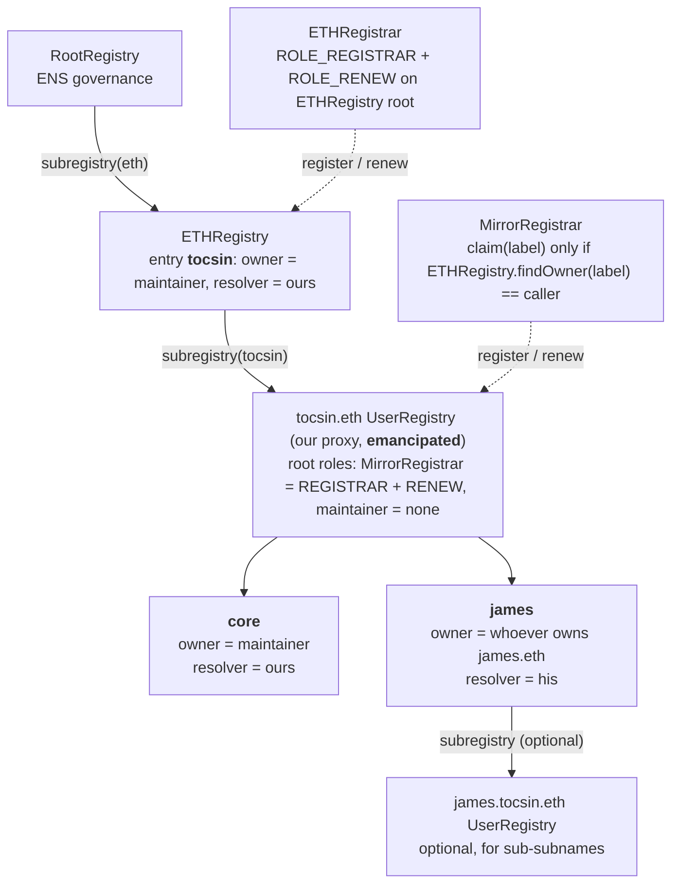
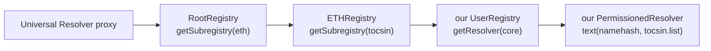

# Tocsin

An append-only log of scam infrastructure on Ethereum that any light-client wallet verifies without trusting an RPC, an explorer, or a security vendor. Anyone writes flags under their own name. Nothing is ever removed. Wallets choose whose flags to believe through signed trust lists, and check every address on the device.

Built at Devcon 8 and ETHGlobal Mumbai, 5 to 7 November 2026. Written up as an ERC draft, "Append-Only Threat Flag Log." Demo: https://tocsin-eth.vercel.app. Site: https://tocsin.eth.limo (once the content hash is set). Repo: https://github.com/easonchai/tocsin.

## The problem

Every wallet decides whether an address is dangerous by asking a company. Explorer labels, phishing databases, and simulation vendors each keep a private list, serve it from an API, and see every address a user asks about. The user cannot verify the answer, and the company learns who is about to pay whom.

That makes a targeted attack cheap. The attacker needs a point in the chain that can lie, and a way to know the lie is landing on the right victim. A security lookup gives them both: one endpoint that can say "clean," and a request that names the victim and the address. A compromised endpoint lies to one user and stays honest to everyone else, so nobody notices.

The one on-chain address list Ethereum had, a sanctions oracle written by one company, stopped updating in March 2026. It died because it had an owner.

## The idea

A contract on Ethereum with no owner, no pause, no upgrade, and no delete. Anyone appends flags about addresses, each under their own namespace. The contract hashes every flag into the writer's chain and into one global chain. The only thing the contract can do to a head is fold one more flag onto it, so a record cannot be changed or removed, not by us, not by the writer. Corrections are new entries.

The log says nothing about who to believe. A trust list is a signed, versioned set of writers with weights and block ranges, published under an ENS name by whoever maintains it. A wallet pins the lists it wants. One listed writer warns. Two independent writers block. The user can always override on the device, and nobody is told.

The attacker cannot lie to you, and cannot tell it is you.

### Append-only by folding, not by list

There is no list in the contract. Nothing is stored per flag. The contract keeps a head and a count per writer, and one pair for the whole log. A head is a running hash. When a writer submits a flag, the contract hashes it and folds it in:

```
head = keccak(head, hash(flag))
```

Then it emits the flag as an event and forgets it. The event, in transaction history, is the only copy. "Append" means fold one more hash into the running value, not push onto an array. Thirty-two bytes in, thirty-two bytes out, however many flags came before.

A fold has one direction. The new head depends on the old head, back to zero, and the contract has no operation that produces a head any other way. You cannot edit a flag, because it was never stored and the head already contains it. You cannot remove one, because every head after it would have to be recomputed without it. You cannot insert or reorder, because every leaf hash includes its sequence number. Append-only is not a rule enforced by access control. It is the only move the contract has.

That is what a wallet needs. It proves the head from a block header, fetches the events from anyone, even a liar, and folds them itself. Landing on the proven head means every flag is real and none is missing. Not landing means something was changed, dropped, or added. One comparison of 32 bytes checks the whole history. A wrong flag is corrected by folding a tombstone after it, and the mistake stays in the record forever, which is the point.

## How the wallet knows without trusting anyone

1. The contract hashes every flag into a chain. The end of the chain, the head, sits in Ethereum's state.
2. The wallet's light client verifies a finalized block from validator signatures. No RPC is trusted.
3. One storage proof against that block gives the wallet the head of every writer it follows.
4. It downloads the flags from anywhere, even a lying RPC, and replays them. They land on the proven head or they do not. Landing means real and complete. Not landing means unverifiable, never clean.
5. It evaluates addresses locally. No per-address query ever leaves the device.

The ERC specifies the contract interface, the leaf encoding, the trust-list encoding, the light-client read procedure, and a recommended reader policy. It does not say who is right.

## Status, 6 November 2026

Built:

- The ERC draft, `erc/eip-draft_threat_flag_log.md`, with a reference implementation that passed nine Foundry tests on the normative cases. Rendered at `site/erc.html` and as `docs/erc-draft.pdf`.
- The landing page, `site/`, on the brand kit under `design/`. The kit has the mark, tokens, the dot-field background, three animated how-it-works scenes, wallet mocks, and a designer handoff.
- The MetaMask Snap UI, specified screen by screen in `docs/plan/demo/snap-ui.md` and mocked in `design/kit/snap.html`.
- The seed list, `docs/plan/demo/seed/`: 92 attacker addresses across eight categories, each with an evidence transaction that was replayed and checked on-chain. Drainer kits, address-poisoning crews, EIP-7702 sweepers, and exploit proceeds.
- ENSv2 on Sepolia, on the October 2026 contract set the Universal Resolver reads: `tocsin.eth` owned by the maintainer key, its subregistry and resolver deployed, `core.tocsin.eth` registered, the subregistry emancipated. Four names in the hub. Two signed lists published under `tocsin.list`: `core.tocsin.eth` naming both writers, `detector.tocsin.eth` naming the detector.
- The MirrorRegistrar, `scripts/ens/contracts/MirrorRegistrar.sol`: whoever owns `<label>.eth` can claim `<label>.tocsin.eth`. Seven fork tests pass against the live Sepolia ENSv2 contracts.
- The claim page, `site/claim.html`: connect a Sepolia wallet, register a `.eth` name if needed, claim the subname, and read the registry's guarantees live. Two names claimed through it from separate keys so far.
- The detector agent, `scripts/agent/detector.mjs`: a template for an automated writer with its own name, `detector.tocsin.eth`. Flags a sample of verified poisoning operators by default; its live mode, a zero-value-transfer heuristic, found two real sprayers in a 40-block scan. Replace the detection, keep the rest.
- The log deployed on Sepolia and seeded: 92 leaves under the core writer key, 25 under the detector's.
- Build tickets under `docs/plan/`, one per piece of the demo. The demo page itself is specified in `docs/plan/demo-page/explainer-spec.md`: pick a scenario, watch an animated explainer of who flagged it and how the rule counts them, then the wallet answers.

On the `feat/demo` branch (PR #3, not merged into main yet): the reader, the Snap, the provider-proxy extension, the lying-RPC proxy, the seeders and the first demo board.

Next on main, in the order the handoff sets:

1. The reader: prove heads through Helios, replay, evaluate.
2. The three hosts: Kohaku module (full claim), MetaMask Snap (privacy half, RPC header), provider-proxy extension.
3. The three demo beats: honest RPC blocks the drainer receiver; a lying RPC produces "unverifiable, chain mismatch"; a mirror restores the block.
4. The backtest, then the Ethereum Magicians thread, then the PR to `ethereum/ERCs`.

## Addresses

All Sepolia. Nothing is on mainnet yet.

| What | Address |
| --- | --- |
| `tocsin.eth` owner (maintainer key, signs both lists) | `0x8E2Cc65A08154a357136C8060DE5232FDdEe3e31` |
| tocsin.eth subregistry (UserRegistry proxy, emancipated) | `0x45cb8bE82D927d8d310cd6B357708b0367B4435B` |
| MirrorRegistrar | `0x9319461337a2c5fb1992fd467708cc46d716a427` |
| Maintainer's PermissionedResolver proxy | `0xedB3Ac2276803E249be532E6Bab168Af4b9549A6` |
| Core writer (92 seed leaves) | `0x36a279136adDde960599fcA356369C04A96D387E` |
| Detector writer (25 leaves) | `0xe3a9678eD0992416C5230f52E3B1fF9775CCA999` |
| `core.tocsin.eth` namehash (32-byte record key, not an address) | `0x0551573d8cba9f9ca27a75d85f7ca91d68a7c6b956c2c582c15d5ca027e18abc` |
| ThreatFlagLog | `0xb639d15a0e7ae24e4c32e851fbe0e57585565b14` |

Names in the hub:

| Name | Owner | Resolver | How it got there |
| --- | --- | --- | --- |
| `core.tocsin.eth` | `0x8E2C…3e31` | `0xedB3…49A6` | registered by the maintainer before emancipation, tx `0xbaf22135…a50fa8ec` |
| `detector.tocsin.eth` | `0x8E2C…3e31` | `0xedB3…49A6` | registered by the maintainer for the detector agent; resolves to the detector writer `0xe3a9…A999` |
| `blockaid.tocsin.eth` | `0x6f1524F5A1152d6b08ef8833E42E4311151e904F` | `0x2a0F1707376b54058A8ecD6d88Ae05810a0Ab084` | claimed through the MirrorRegistrar, tx `0xf1cb08bf…59d7699f` |
| `scamsniffer.tocsin.eth` | `0x3a05D06949b9890aEAD4700AA5ECEbf4D1BA0Ba0` | `0xB28A4cd2eD1f11e5dbB1a3f2ABf6A83EE63b219f` | claimed through the MirrorRegistrar, tx `0xdb08b8b0…b39496f46` |

The two claims come from separate keys, each of which first registered its own `.eth` name (`blockaid.eth` in `0x5ada2ed4…c81431770`, `scamsniffer.eth` in `0x89b3173d…ca307009`) and deployed its own resolver. They are demo claims by keys we control, named after the organisations as placeholders. The real ones belong to whoever owns `blockaid.eth` and `scamsniffer.eth` on mainnet when the hub goes there. `etherscan.eth` is on the Sepolia registrar's reserved list, so that role is now `scamsniffer`. To claim your own: `docs/claim-a-name.md`.

Published lists, both signed by the maintainer key `0x8E2C…3e31`:

| Name | Record | Writers |
| --- | --- | --- |
| `core.tocsin.eth` | `tocsin.list` version 3, root `0x62ea0207…`, tx `0xe88b75c1…9178047d` | core writer `0x36a2…387E` at weight 255 (92 leaves), detector writer `0xe3a9…A999` at weight 1, warn (25 leaves) |
| `detector.tocsin.eth` | `tocsin.list` version 2, root `0x30cf0073…`, tx `0xe2b7a7d9…a995887c` | detector writer `0xe3a9…A999` at weight 255 (25 leaves) |

The documents the records point at are `docs/plan/demo/seed/core.list.json` and `detector.list.json`.

Hub setup on 6 November 2026: MirrorRegistrar deployed in `0x62b66b34…7cc49bd4` (around block 12077305), granted registrar and renew in `0xf93fd6a1…6378c265` (block 12077307), subregistry emancipated in `0x50be9f1f…f9a36c1` (block 12077441). Checked afterwards: `isEmancipated()` is true, `hasAssignees(ROOT, dangerousRoles)` is false, every name resolves through the Universal Resolver proxy. Current state: `scripts/ens/state.sepolia.json` and `scripts/ens/claims.sepolia.json`; full hashes in ticket 15.

ENSv2 Sepolia contracts the scripts call, the 1 October 2026 set from `@ensdomains/ensjs` 5.2.12 (`ensL1Contracts[11155111]`), each checked for code on 6 November. The `deployments/sepolia` folder in `ensdomains/contracts-v2` holds the older June 2026 set, which still answers calls but is not the set the Universal Resolver reads, so do not take addresses from it.

| Contract | Address |
| --- | --- |
| Universal Resolver (proxy) | `0xeEeEEEeE14D718C2B47D9923Deab1335E144EeEe` |
| ETHRegistry | `0xD4eBcbBdF463C9c45784603Db0dDD499BC44A8B4` |
| ETHRegistrar | `0xf633e7FC17e2bbE0D0965D18ec1821dcB754a3d3` |
| VerifiableFactory | `0xDa70306C98E97eCe36F997a21368e53298572991` |
| PermissionedResolverImpl | `0x115eb53F0c60696633855F90b138178Fb40b2b2C` |
| UserRegistryImpl | `0x9BD8a88719068D09ecee662f36C0E3856708366a` |
| MockUSDC (registration fee) | `0x240b0316Df57887DBBE58b586508b19e633a14aa` |

Re-check any address with `cast code` before it touches real funds.

The namehash is how ENS turns a name into a fixed 32-byte key, by hashing the labels from the right: `node("core.tocsin.eth") = keccak(node("tocsin.eth") ‖ keccak("core"))`, down to 32 zero bytes for the root. Resolvers store records under that key. The October resolver's setters take the DNS-encoded name and derive the key themselves, so the list record is written with `setText(dns("core.tocsin.eth"), "tocsin.list", value)` and read back through `resolve()` under `0x0551…8abc`. A labelhash is different: `keccak("core")` alone, which registries use because each registry already knows its parent.

## Names and lists

Two ways to publish a list, and both work with the same reader:

- Under your own name. Put the `tocsin.list` text record on a name you own. (The ERC draft names the key `erc-threat-flag-log.list`, becoming `erc-N.list` once numbered; the Sepolia deployment uses `tocsin.list` until then. Any key string works, readers just have to agree on it.) The ERC locates a list by any name record and authenticates it by the maintainer's signature, so no hub is needed. This is the token-lists model and it is the primary one.
- Under the hub. Own `james.eth`, claim `james.tocsin.eth` in one transaction through the MirrorRegistrar. The subname's expiry mirrors the `.eth` name's. After setup, no account holds a dangerous role on the hub registry, so nobody can revoke a claimed name or change its resolver. Check `hasAssignees(0, dangerousRoles)` on the registry.

`core.tocsin.eth` is our own list: the 92 seed entries under the core writer plus the detector at warn weight, signed by the maintainer key. Wallets ship names like browsers ship root CAs, and the user sees "flagged by seal.eth, listed by core.tocsin.eth," never a hex address.

### How the hub is wired on ENSv2

ENSv2 is a tree of registries, not one flat mapping. Each name's entry in its parent registry carries a `subregistry` pointer, and the names under it live in that child contract. A registrar is any contract that holds `ROLE_REGISTRAR` on a registry's root resource. The ETH Registrar is one for the `.eth` registry; the MirrorRegistrar is one for the `tocsin.eth` registry.



Attaching the registrar is three transactions, all in `scripts/ens/setup-all.mjs`: deploy the UserRegistry through the Verifiable Factory, `setSubregistry` on the ETHRegistry so `tocsin.eth` points at it, `grantRootRoles(ROLE_REGISTRAR | ROLE_RENEW, registrar)` on the new registry. Then every other root role is revoked.

Resolving `core.tocsin.eth` is a walk down the tree, and every step is a storage read:



The Tocsin reader does the same walk through `eth_getProof` against the light client's state root, so the list record is verified the same way the log head is. That is why the ERC treats a record resolved through an unverifiable gateway as unverified.

Who can do what once setup has run:

| | register | renew | set resolver | set subregistry | unregister | transfer | upgrade |
| --- | --- | --- | --- | --- | --- | --- | --- |
| MirrorRegistrar | yes | yes | no | no | no | no | no |
| maintainer (owns tocsin.eth) | no | no | no | no | no | no | no |
| owner of james.tocsin.eth | | | own name | own name | no | own name | no |

The maintainer can still repoint `tocsin.eth`'s subregistry in the ETHRegistry, which replaces the whole directory in one visible transaction. It cannot touch a name inside it.

### The access control, and what setup does with it

Enhanced Access Control is the permission system every ENSv2 contract shares. A resource is the thing being protected: in a registry, each name, keyed by its labelhash, plus `ROOT_RESOURCE` for the whole contract. A role is one permission, one bit in a 256-bit bitmap, always held on a resource. Set-resolver on `core` reaches only core. Set-resolver on the root reaches every name. Every role has an admin role at `role << 128`, and only an admin holder can grant or revoke that role. A permission check looks at the name and at the root, and allows the action if the role is in either.

The setup script spends the maintainer's roles in this order:

```
1. initialize(maintainer, root roles)      registrar, register-reserved, set-parent, renew, set-subregistry,
                                            set-resolver, upgrade, each with its admin. Only the factory's
                                            initialize can set admin roles on the root freely.
2. setParent(ETHRegistry, "tocsin")         uses set-parent
3. grantRootRoles(REGISTRAR | RENEW, registrar)   uses the two admin roles
4. register("core", maintainer, 0, resolver, owner roles, expiry)   uses registrar; the owner-role bitmap
                                            is what core's owner gets on core only: set-resolver, set-subregistry,
                                            their admins, and transfer-admin
5. revokeRootRoles(everything, maintainer)  emancipation, one way: re-granting needs an admin role, and none is held
```

After step 5:

```
ROOT_RESOURCE   MirrorRegistrar  REGISTRAR, RENEW        operational roles; cannot change or delete any name
                maintainer       nothing
"core"          maintainer       SET_RESOLVER, SET_SUBREGISTRY, their admins, CAN_TRANSFER_ADMIN
"james"         james            the same, on his own name, once he claims
```

A bug in the registrar cannot damage a claimed name, because it holds no role that can change or delete one. Each claimant controls only their own name and can delegate it with their admin roles or lock it by revoking them. The hub has no master key: `hasAssignees(0, dangerousRoles)` returns false, which is what the ENS docs mean by emancipated.

The resolver uses the same system and is not emancipated, on purpose. The maintainer keeps every record role on it so `core.tocsin.eth` can be updated. The deployed resolver also has `grantSetterRoles(setter, account)`, which, given `setText` calldata for the `tocsin.list` key, hands one account the right to set that one text key. That is how a hot publishing key would get `tocsin.list` without owning the name. The setup script does not use it yet; the maintainer key sets the record directly.

## Repo map

| Path | What it is |
| --- | --- |
| `erc/eip-draft_threat_flag_log.md` | The ERC draft, EIP-1 format |
| `site/` | Landing page, ERC page, the claim page (`claim.html`), fonts, `build.sh` for an IPFS-ready `dist/` |
| `design/` | Brand kit, scenes, mocks, Snap screens, explorations, designer handoff (`design/README.md`) |
| `docs/erc-draft.pdf` | The ERC as a PDF |
| `docs/claim-a-name.md` | How anyone claims `<label>.tocsin.eth` on Sepolia and publishes under it |
| `docs/pitch/arguments.md` | Pitch copy: the supply-chain argument, fake heads, why not ENS, one-liners |
| `docs/plan/demo/` | Demo spec, Snap UI spec, seed list, build tickets 01 to 15 |
| `docs/plan/log-contract/` | Contract spec and tickets |
| `docs/wallet-integrations.md` | The three hosts: Kohaku, Snap, extension |
| `docs/ideas/` | Parked ideas, such as the open-silicon signer |
| `scripts/ens/` | ENSv2 Sepolia: `setup-all.mjs` registers, sets up the hub, claims, publishes the lists, and emancipates; `common.mjs` holds the addresses; the MirrorRegistrar and its fork tests |
| `scripts/seed/` | Seed the log from `core.json` |
| `scripts/agent/` | The detector: an agent writer with its own name |
| `scripts/build-erc.mjs` | Regenerates `site/erc.html` from the markdown |
| `HANDOFF.md` | Settled decisions, build order, open items |
| `dapp/packages/foundry` | The log contract, its Foundry tests, and the CREATE2 deploy script (Scaffold-ETH 2, Foundry flavour) |
| `GLOSSARY.md` | Log, writer, leaf, subject, head, maintainer, reader |

## Who calls the log

The log has two state-changing functions and no others. Nothing in it runs on a schedule.

| Transition | Caller | Why they pay gas | If nobody calls |
| --- | --- | --- | --- |
| `append(leaves)` | The writer, from its own account | Its flags only reach wallets through the lists that name it, so publishing is its distribution | Nothing changes. The heads stay where they are and readers keep the last state they proved |
| `appendSigned(writer, leaves, deadline, nonce, sig)` | Any relayer | The writer sponsors the relayer, or runs its own, so its signing key never holds gas | The signed batch expires at its deadline and the writer's nonce is untouched, so the writer re-signs or sends `append` itself |

Nobody can stop a writer: a relayer that refuses a batch is bypassed by sending `append` directly.

## Write an agent that flags

Any process with a key can be a writer. The detector in `scripts/agent/detector.mjs` is the template: it finds candidates, attaches on-chain evidence, appends them under its own key, and gets its own name and list. Keep the shape, replace the detection.

The one function to write returns candidates. Each one needs the chain, the subject, a category from the ERC's table, the transaction that proves the subject's role, and the block it was seen in:

```js
async function findCandidates() {
  // your detection here: a heuristic, a model, a feed you trust, a human queue
  return [{
    chainId: 1,
    subject: '0x5126633bCFdb9E4A2FE7AB445394AE0a217f9120',
    category: 'POISONING_OPERATOR',
    evidence: '0x3725c75cfdcd2a59dc1721ded1001aa0a83123c1f63e52e0043de64565af9dce',
    seenBlock: 21_904_118,
    note: 'sent zero-value USDT to 212 addresses in 3 txs',
  }];
}
```

The template dedupes against what the writer already flagged, caps the batch, writes `docs/plan/demo/seed/detector.json`, then calls `append` on the log from the writer's key. The log assigns the sequence numbers and folds each flag into that writer's head. Nothing else in the repo has to know the writer exists.

```
node --env-file=scripts/.env scripts/agent/detector.mjs --dry               # find and print, append nothing
node --env-file=scripts/.env scripts/agent/detector.mjs --limit 5           # append the first five new candidates
node --env-file=scripts/.env scripts/agent/detector.mjs --source live       # the built-in zero-value-transfer heuristic on mainnet
```

The key is `DETECTOR_PRIVATE_KEY` in `scripts/.env`. Load it from a secret store into that variable; the file never holds it in a commit. The built-in live source is deliberately crude, which is why its writer sits at warn weight in `core.tocsin.eth`: a reader that follows it is warned, not blocked, until a second independent writer agrees.

To be found by wallets, the writer needs a name and a list. Own `yourname.eth` on Sepolia, claim `yourname.tocsin.eth` from `site/claim.html` (or let `setup-all.mjs` do it with your key in a claimant slot), set the name's addr record to the writer key, and publish a `tocsin.list` text record naming the writer. The `publishList` function in `scripts/ens/setup-all.mjs` builds, signs and sets that record; point it at your name and resolver. From then on a wallet that adds your name to its followed lists syncs your flags and verifies them against the chain, with no call to you.

## Test and deploy the log

The contract has no owner, so a deploy hands nothing over afterwards. Tests first:

```sh
cd dapp/packages/foundry
forge test
```

Sepolia only for now. The address comes from the deterministic deployment proxy `0x4e59b44847b379578588920cA78FbF26c0B4956C` with salt zero, so it is the same on every chain. For the current build it is `0xC5616bb2FDCcdD761aa969c5C0dFb3D5c7d93865`. Any edit to the contract or to the compiler settings in `foundry.toml` moves it.

One-time setup:

1. `cd dapp && yarn install`
2. Make a keystore with `cast wallet import <name> --interactive` (or `yarn generate`) and fund its address with Sepolia ETH. Never pass `--private-key`.
3. In `dapp/packages/foundry/.env`, which git ignores, set `SEPOLIA_RPC_URL`, `ETHERSCAN_API_KEY`, and `DEPLOYER_KEYSTORE_ACCOUNT=<name>`. `.env.example` lists the names.

Deploy, verify, and smoke-test, from the repo root:

```sh
bash dapp/packages/foundry/scripts-sh/deploy-sepolia.sh
```

The script refuses to start unless the normative and boundary suites pass, the chain id is 11155111, and the predicted address has no code. It prints the address, the deployer, its live balance, the live gas price, and the estimated cost, then waits for you to type `DEPLOY`. It deploys, verifies on Etherscan and Sourcify, and appends one flag from the deployer (category 128, subject the deployer, so it names nobody else). Then it reads `writerSeq(deployer)` and `globalSeq()` back from the chain and expects 1 and 1. If a step after the deploy fails, run the retry commands it prints rather than the script again, because the address is already taken.

To check a deployment yourself:

```sh
cast code 0xC5616bb2FDCcdD761aa969c5C0dFb3D5c7d93865 --rpc-url "$SEPOLIA_RPC_URL" | cast keccak
cast call 0xC5616bb2FDCcdD761aa969c5C0dFb3D5c7d93865 "globalSeq()(uint64)" --rpc-url "$SEPOLIA_RPC_URL"
```

The first should print `0xdc59334640b4a42e076253a531f923cb65fa6e1091f535da8ff17ce74c24b93c`, the runtime code hash in the ERC's Deployment section.

For a local chain, SE-2's usual `yarn chain` and `yarn deploy` in `dapp/` deploy to the same address on anvil.

## Run things

Preview the site from the repo root:

```
python3 -m http.server 8732      # open http://127.0.0.1:8732/site/
```

Rebuild the ERC page after editing the markdown:

```
npm install
npm run build:erc
```

Publish the site to IPFS and ENS:

```
./site/build.sh                      # self-contained dist/
ipfs add -r --cid-version 1 dist     # then set the tocsin.eth contenthash to ipfs://<CID>
```

ENS and seeding on Sepolia, with `scripts/.env` filled from `scripts/.env.example`:

```
node --env-file=scripts/.env scripts/seed/seed-core.mjs     # needs LOG_ADDRESS; already run
node --env-file=scripts/.env scripts/ens/setup-all.mjs      # tocsin.eth, hub, registrar, core, claims, lists, emancipate
node --env-file=scripts/.env scripts/agent/detector.mjs     # the detector writer; needs DETECTOR_PRIVATE_KEY
```

`setup-all.mjs` takes `--keep-roles` (skip emancipation), `--skip-claims`, and `--skip-lists`, and skips any step already in place on chain. Anyone else claims a name from `site/claim.html`.

Registrar tests, against a Sepolia fork:

```
forge test --root scripts/ens --fork-url $SEPOLIA_RPC --fork-block-number <recent>
```

## What a flag costs

Writers pay. Readers pay nothing but bandwidth. A flag in a batch costs about 10,000 gas, most of it the event the contract emits. A flag sent alone costs about 52,000 gas because of the transaction overhead, so writers batch. The test suite measures a 100-leaf batch at 986,455 gas, or 9,865 a flag, in `dapp/packages/foundry/snapshots/ThreatFlagLog.json` (`forge test --match-contract Gas` regenerates it). That figure uses Cancun gas rules. A Sepolia fork, which runs newer rules, charged a single-leaf append about four times what the test EVM did, so re-measure on Sepolia after the deploy before quoting it.

With ETH at $2,200:

| Base fee | One flag, batched | 50,000 flags a year |
| --- | --- | --- |
| 0.2 gwei | under half a cent | about $220 |
| 1 gwei | about 2 cents | about $1,100 |
| 10 gwei | about 22 cents | about $11,000 |

The base fee moves fifty-fold within a day, so the sentence for a pitch is "about half a cent a flag." Calldata repricing proposed for Glamsterdam would raise the current encoding by about 40 percent; the ERC notes it and a packed encoding would absorb it.

A reader downloads only the writers it pins. Fifty thousand flags a year is about 5 MB packed. A fresh install syncs from a recent anchor and never replays from the beginning.

## CROPS

The Ethereum Foundation's test for the properties Ethereum must keep: censorship resistance, open source, privacy, security.

**CR.** Nothing we run sits between the user and the data. The log has no owner and `append` is open to anyone. Entries are verified by replay against a proven head, so any RPC, mirror, or snapshot host is interchangeable, and a lying one produces "unverifiable," not a false "clean." Lists are signed by their maintainer and pinned on first use, so losing our name or domain cannot swap a reader's list. The hub registry is emancipated. A block is always overridable on the device.

**O.** MIT for this repository, CC0 for the ERC. It builds from the repo alone. No backend, indexer, or API of ours.

**P.** The RPC sees one storage proof for the writers in the user's lists and bounded log ranges by writer, over the EF's Anon-RPC worker where the host allows it. Nobody sees the recipient, the spender, or the user's own address in connection with a check, because every check runs on the device against a locally replayed set.

**S.** The wallet holds no keys of ours and sends no user data anywhere. Trust assumptions, in order: the sync committee and the pinned weak-subjectivity checkpoint; the maintainers of the lists the user pinned; the writers those lists name, bounded by block ranges. Walkaway test: delete the team, the domain, and every server, and the log, the pinned lists, the names, and the wallet keep working.

## Before the ERC is posted

1. Run the backtest: the share of lost dollars that went to an address which met the write criteria at least an hour before the loss. Under 10 percent, stop. Over 25 percent, proceed.
2. Create the Ethereum Magicians thread and replace the `TODO` in `discussions-to`.
3. Open the PR against `ethereum/ERCs`.

## Prize submissions

### ENS: Best Use of ENSv2

**Why we are applicable**

Tocsin is a log of scam addresses on Ethereum that nothing can edit. People hear "log" and picture a list stored in a contract. There is no list. The contract keeps one 32-byte running hash per writer. When a writer adds a flag, the contract hashes the flag and folds it into that hash, `head = keccak(head, hash(flag))`, emits the flag as an event, and forgets it. The fold only goes one way. Nobody can edit, remove, or reorder a flag, because the contract has no operation that produces a head any other way. A wallet proves the head from a block header, downloads the events from anyone, folds them itself, and compares 32 bytes. Match means every flag is real and none is missing. Mismatch means someone lied.

That leaves two questions the log cannot answer: which writers should a wallet believe, and where does it find their signed lists. ENSv2 answers both. Names are the trust layer of the product, not an address book.

On Sepolia, `tocsin.eth` points at [its own UserRegistry subregistry](https://github.com/easonchai/tocsin/blob/main/scripts/ens/setup-all.mjs#L60), deployed through the Verifiable Factory, with a Permissioned Resolver per account. A 60-line [MirrorRegistrar](https://github.com/easonchai/tocsin/blob/main/scripts/ens/contracts/MirrorRegistrar.sol) mints `label.tocsin.eth` to whoever owns `label.eth`, copies the `.eth` expiry, and lets anyone `sync` it after a renewal. `blockaid.tocsin.eth` and `scamsniffer.tocsin.eth` were [claimed that way](https://github.com/easonchai/tocsin/blob/main/scripts/ens/setup-all.mjs#L104-L111) from two separate keys, each with its own resolver. Then the maintainer [revoked every root role it held](https://github.com/easonchai/tocsin/blob/main/scripts/ens/setup-all.mjs#L158), its own registrar role included. From that point only the registrar contract can mint, and no account can change, transfer, or take a name. `isEmancipated()` returns true on the subregistry, and [the claim page reads that from the chain](https://github.com/easonchai/tocsin/blob/main/site/claim.html#L208).

The lists live on the names. `core.tocsin.eth` carries a `tocsin.list` text record, [built and signed here](https://github.com/easonchai/tocsin/blob/main/scripts/ens/setup-all.mjs#L132-L148): the list's hash, a version, the maintainer's EIP-712 signature, and the document URI. A wallet pins the maintainer key the first time it follows a list, so a lapsed or re-sold name cannot swap the list underneath it. `detector.tocsin.eth` is an automated writer with 25 flags in the log. Its addr record names the writer key, its own list sits on the name, and the core list carries it at warn weight. Every record above resolves through the Universal Resolver proxy, the same path every wallet and app takes. [Seven fork tests](https://github.com/easonchai/tocsin/blob/main/scripts/ens/test/MirrorRegistrar.t.sol) run against the deployed ENSv2 contracts.

**Link to the line of code**

https://github.com/easonchai/tocsin/blob/main/scripts/ens/contracts/MirrorRegistrar.sol#L50

That is the `HUB.register` call: the subregistry minting a name with the claimant's role bitmap and the expiry mirrored from the `.eth` registry, right after the ownership check. Subregistry `0x45cb8bE82D927d8d310cd6B357708b0367B4435B`, registrar `0x9319461337a2c5fb1992fd467708cc46d716a427`, both on Sepolia. Transaction hashes are in `docs/plan/demo/issues/15-mirror-registrar.md`.

**Ease of use: 7 out of 10**

Per-name registries, per-account resolvers, and revocable roles made "a directory nobody can take back" a one-day build, and the deployed contracts match the docs. Three points off for addresses, which cost us the second day. The `deployments/sepolia` folder in the `contracts-v2` repo is a June 2026 set that is still live but that the Universal Resolver does not read. We built the whole hub on it, and none of the names resolved anywhere. The set that resolvers use is only in the `ensjs` source.

**Feedback for the sponsor**

1. Publish the addresses once, in one place, and say which set is current. The Deployments page renders them from a React component, so they are missing from `llms-full.txt` and from any scrape. The `contracts-v2` repo ships the June set with nothing marking it stale. We found the October set in `@ensdomains/ensjs` `ensL1Contracts[11155111]`. A plain `deployments.json` next to a "resolvers read this set" line would have saved us a day.
2. `VerifiableFactory.deployProxy` reverts with no error data when the salt was already used, so an idempotent script cannot find the proxy it deployed last time. A `predictProxyAddress(sender, salt)` view, or a typed revert carrying the address, would fix that.
3. Reserved labels are invisible until you pay for them. `etherscan.eth` is reserved: `getStatus` returns 1, `isAvailable` returns false, and `getRegisterPrice` reverts with `NameNotAvailable`. The docs do not list the reserved set or document status 1, and a price view that reverts is a surprise. Document the enum and make `isAvailable` the stated check.
4. There is no end-to-end example of registering a `.eth` name on Sepolia with the v2 registrar: commit, wait for `MIN_COMMITMENT_AGE`, `register` with its eight arguments, and the test USDC mint and approve. `llms-full.txt` serves the v1 page with a callout under "ETH Registrar." We read the ABI instead.
5. `UserRegistryImpl.initialize` grants must include the admin bits for any role you will later grant to a registrar, or the grant reverts. The docs mention it. A warning next to the initialize example would stop the dead-end deploy.
6. The role bitmap composer is good. An emancipation recipe next to it, `revokeRootRoles(roles(ROOT, me), me)` followed by `isEmancipated()`, would make the strongest access-control feature easy to show.
7. Worked without friction: the Universal Resolver returning a freshly claimed subname within seconds, the Verifiable Factory's predictable addresses on first deploy, and the resolver's DNS-name setters and `grantSetterRoles` behaving exactly as the docs describe.

## License

MIT for this repository. CC0 for everything under `erc/`, as the EIP process requires.
