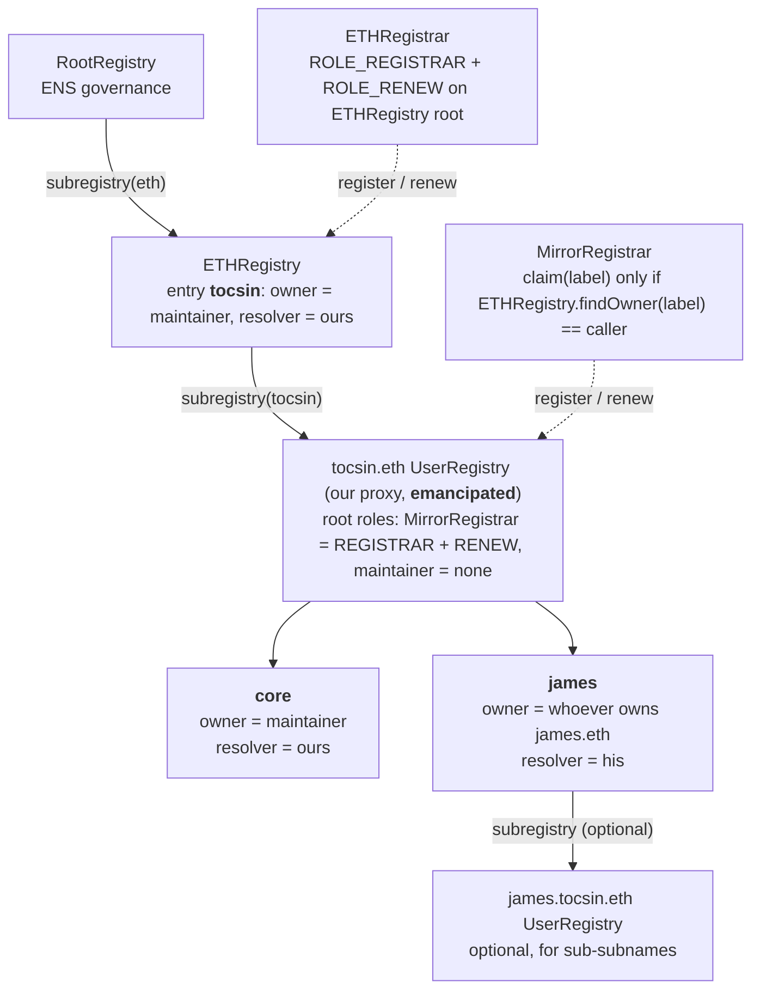
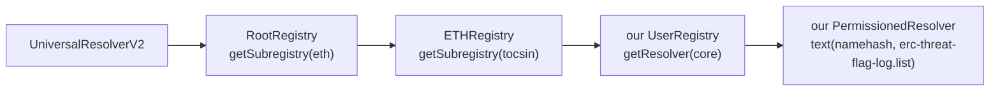

# Tocsin

An append-only log of scam infrastructure on Ethereum that any light-client wallet verifies without trusting an RPC, an explorer, or a security vendor. Anyone writes flags under their own name. Nothing is ever removed. Wallets choose whose flags to believe through signed trust lists, and check every address on the device.

Built at Devcon 8 and ETHGlobal Mumbai, 5 to 7 November 2026. Written up as an ERC draft, "Append-Only Threat Flag Log." Site: https://tocsin.eth.limo (once the content hash is set). Repo: https://github.com/easonchai/tocsin.

## The problem

Every wallet decides whether an address is dangerous by asking a company. Explorer labels, phishing databases, and simulation vendors each keep a private list, serve it from an API, and see every address a user asks about. The user cannot verify the answer, and the company learns who is about to pay whom.

That makes a targeted attack cheap. The attacker needs a point in the chain that can lie, and a way to know the lie is landing on the right victim. A security lookup gives them both: one endpoint that can say "clean," and a request that names the victim and the address. A compromised endpoint lies to one user and stays honest to everyone else, so nobody notices.

The one on-chain address list Ethereum had, a sanctions oracle written by one company, stopped updating in March 2026. It died because it had an owner.

## The idea

A contract on Ethereum with no owner, no pause, no upgrade, and no delete. Anyone appends flags about addresses, each under their own namespace. The contract hashes every flag into the writer's chain and into one global chain. The only thing the contract can do to a head is fold one more flag onto it, so a record cannot be changed or removed, not by us, not by the writer. Corrections are new entries.

The log says nothing about who to believe. A trust list is a signed, versioned set of writers with weights and block ranges, published under an ENS name by whoever maintains it. A wallet pins the lists it wants. One listed writer warns. Two independent writers block. The user can always override on the device, and nobody is told.

The attacker cannot lie to you, and cannot tell it is you.

## How the wallet knows without trusting anyone

1. The contract hashes every flag into a chain. The end of the chain, the head, sits in Ethereum's state.
2. The wallet's light client verifies a finalized block from validator signatures. No RPC is trusted.
3. One storage proof against that block gives the wallet the head of every writer it follows.
4. It downloads the flags from anywhere, even a lying RPC, and replays them. They land on the proven head or they do not. Landing means real and complete. Not landing means unverifiable, never clean.
5. It evaluates addresses locally. No per-address query ever leaves the device.

The ERC specifies the contract interface, the leaf encoding, the trust-list encoding, the light-client read procedure, and a recommended reader policy. It does not say who is right.

## Status, 6 November 2026

Built:

- The ERC draft, `erc/eip-draft_threat_flag_log.md`, with a reference implementation that passed nine Foundry tests on the normative cases. Rendered at `site/erc.html` and as `docs/erc-draft.pdf`.
- The landing page, `site/`, on the brand kit under `design/`. The kit has the mark, tokens, the dot-field background, three animated how-it-works scenes, wallet mocks, and a designer handoff.
- The MetaMask Snap UI, specified screen by screen in `docs/plan/demo/snap-ui.md` and mocked in `design/kit/snap.html`.
- The seed list, `docs/plan/demo/seed/`: 92 attacker addresses across eight categories, each with an evidence transaction that was replayed and checked on-chain. Drainer kits, address-poisoning crews, EIP-7702 sweepers, and exploit proceeds.
- ENSv2 on Sepolia: `tocsin.eth` registered, plus scripts that set up the name's own subregistry and resolver, register `core.tocsin.eth`, and emancipate the registry.
- The MirrorRegistrar, `scripts/ens/contracts/MirrorRegistrar.sol`: whoever owns `<label>.eth` can claim `<label>.tocsin.eth`. Seven fork tests pass against the live Sepolia ENSv2 contracts.
- Scripts to seed the log and publish the signed `core` list, waiting on the contract address.
- Build tickets under `docs/plan/`, one per piece of the demo.

Next, in the order the handoff sets:

1. Deploy the log on Sepolia through the CREATE2 proxy, seed it, publish `core.tocsin.eth`.
2. The reader: prove heads through Helios, replay, evaluate.
3. The three hosts: Kohaku module (full claim), MetaMask Snap (privacy half, RPC header), provider-proxy extension.
4. The three demo beats: honest RPC blocks the drainer receiver; a lying RPC produces "unverifiable, chain mismatch"; a mirror restores the block.
5. The backtest, then the Ethereum Magicians thread, then the PR to `ethereum/ERCs`.

## Addresses

All Sepolia. Nothing is on mainnet yet.

| What | Address |
| --- | --- |
| `tocsin.eth` owner (maintainer of `core`) | `0x36a279136adDde960599fcA356369C04A96D387E` |
| tocsin.eth subregistry (UserRegistry proxy, emancipated) | `0x61F6B44C598d7171947eE059e1d486eDd6950b88` |
| MirrorRegistrar | `0x081d9c8ea86b6022c3e2f0a61f5c26cf9a7cb436` |
| Maintainer's PermissionedResolver proxy | `0x1cBF0A41B77416381C6eEC40b703BBe4722519E6` |
| `core.tocsin.eth` namehash (32-byte record key, not an address) | `0x0551573d8cba9f9ca27a75d85f7ca91d68a7c6b956c2c582c15d5ca027e18abc` |
| ThreatFlagLog | not deployed yet; goes into `scripts/.env` as `LOG_ADDRESS` |

Names claimed through the MirrorRegistrar so far, each from its own key:

| Name | Owner | Resolver | Claim tx |
| --- | --- | --- | --- |
| `blockaid.tocsin.eth` | `0x6f1524F5A1152d6b08ef8833E42E4311151e904F` | `0x27209FA079b88bf30DCc43d4324D7c8A4f4E2b33` | `0x59611357…c3c976` |
| `etherscan.tocsin.eth` | `0x3a05D06949b9890aEAD4700AA5ECEbf4D1BA0Ba0` | `0xf8c4d03277e3a124821c3D426fEAE6056Ad9aA92` | `0x456da39e…557808` |

These are demo claims by keys we control, named after the organisations as placeholders. The real ones belong to whoever owns `blockaid.eth` and `etherscan.eth` on mainnet when the hub goes there. To claim your own: `docs/claim-a-name.md`.

Registered 6 November 2026. `tocsin.eth`: tx `0x9e8b2a8d…20ed0f`. Hub setup through emancipation: txs in `scripts/ens/state.sepolia.json`'s commit and in ticket 15. Checked after setup: no account holds a dangerous root role on the subregistry, the registrar holds registrar and renew, `core.tocsin.eth` resolves to the maintainer.

ENSv2 Sepolia contracts the scripts call, from the `contracts-v2` deployment of 29 June 2026, each checked for code on 6 November:

| Contract | Address |
| --- | --- |
| ETHRegistry | `0x67b728a792e789a8978b30cF1b3b641f19354b43` |
| ETHRegistrar | `0xa4449a0dd2b83007553d9b1d28b583a46a805a30` |
| VerifiableFactory | `0x118Bc31A50d559F7015a8Da26d54B3b030CdB70F` |
| PermissionedResolverImpl | `0x7e4b2d59938930168024201752ee5503df402303` |
| UserRegistryImpl | `0x840Fa461059862Ea466A711E8C98c8dE732061C0` |
| UniversalResolverV2 | `0x85edf8b6b7d4211e2b07aa687506b746357b92cf` |
| MockUSDC (registration fee) | `0xd3322b29a7bdee707d1684676f149bf41aa3422f` |

Re-check any address with `cast code` before it touches real funds.

The namehash is how ENS turns a name into a fixed 32-byte key, by hashing the labels from the right: `node("core.tocsin.eth") = keccak(node("tocsin.eth") ‖ keccak("core"))`, down to 32 zero bytes for the root. Resolvers store records under that key, so the list record is written with `setText(0x0551…8abc, "erc-threat-flag-log.list", value)` and read back the same way. A labelhash is different: `keccak("core")` alone, which registries use because each registry already knows its parent.

## Names and lists

Two ways to publish a list, and both work with the same reader:

- Under your own name. Put the `erc-threat-flag-log.list` text record on a name you own. The ERC locates a list by any name record and authenticates it by the maintainer's signature, so no hub is needed. This is the token-lists model and it is the primary one.
- Under the hub. Own `james.eth`, claim `james.tocsin.eth` in one transaction through the MirrorRegistrar. The subname's expiry mirrors the `.eth` name's. After setup, no account holds a dangerous role on the hub registry, so nobody can revoke a claimed name or change its resolver. Check `hasAssignees(0, dangerousRoles)` on the registry.

`core.tocsin.eth` is our own list: the 92 seed entries, one writer, signed by the maintainer key. Wallets ship names like browsers ship root CAs, and the user sees "flagged by seal.eth, listed by core.tocsin.eth," never a hex address.

### How the hub is wired on ENSv2

ENSv2 is a tree of registries, not one flat mapping. Each name's entry in its parent registry carries a `subregistry` pointer, and the names under it live in that child contract. A registrar is any contract that holds `ROLE_REGISTRAR` on a registry's root resource. The ETH Registrar is one for the `.eth` registry; the MirrorRegistrar is one for the `tocsin.eth` registry.



Attaching the registrar is three transactions, all in `scripts/ens/2-setup-core.mjs`: deploy the UserRegistry through the Verifiable Factory, `setSubregistry` on the ETHRegistry so `tocsin.eth` points at it, `grantRootRoles(ROLE_REGISTRAR | ROLE_RENEW, registrar)` on the new registry. Then every other root role is revoked.

Resolving `core.tocsin.eth` is a walk down the tree, and every step is a storage read:



The Tocsin reader does the same walk through `eth_getProof` against the light client's state root, so the list record is verified the same way the log head is. That is why the ERC treats a record resolved through an unverifiable gateway as unverified.

Who can do what once setup has run:

| | register | renew | set resolver | set subregistry | unregister | transfer | upgrade |
| --- | --- | --- | --- | --- | --- | --- | --- |
| MirrorRegistrar | yes | yes | no | no | no | no | no |
| maintainer (owns tocsin.eth) | no | no | no | no | no | no | no |
| owner of james.tocsin.eth | | | own name | own name | no | own name | no |

The maintainer can still repoint `tocsin.eth`'s subregistry in the ETHRegistry, which replaces the whole directory in one visible transaction. It cannot touch a name inside it.

### The access control, and what setup does with it

Enhanced Access Control is the permission system every ENSv2 contract shares. A resource is the thing being protected: in a registry, each name, keyed by its labelhash, plus `ROOT_RESOURCE` for the whole contract. A role is one permission, one bit in a 256-bit bitmap, always held on a resource. Set-resolver on `core` reaches only core. Set-resolver on the root reaches every name. Every role has an admin role at `role << 128`, and only an admin holder can grant or revoke that role. A permission check looks at the name and at the root, and allows the action if the role is in either.

The setup script spends the maintainer's roles in this order:

```
1. initialize(maintainer, root roles)      registrar, register-reserved, set-parent, renew, set-subregistry,
                                            set-resolver, upgrade, each with its admin. Only the factory's
                                            initialize can set admin roles on the root freely.
2. setParent(ETHRegistry, "tocsin")         uses set-parent
3. grantRootRoles(REGISTRAR | RENEW, registrar)   uses the two admin roles
4. register("core", maintainer, 0, resolver, owner roles, expiry)   uses registrar; the owner-role bitmap
                                            is what core's owner gets on core only: set-resolver, set-subregistry,
                                            their admins, and transfer-admin
5. revokeRootRoles(everything, maintainer)  emancipation, one way: re-granting needs an admin role, and none is held
```

After step 5:

```
ROOT_RESOURCE   MirrorRegistrar  REGISTRAR, RENEW        operational roles; cannot change or delete any name
                maintainer       nothing
"core"          maintainer       SET_RESOLVER, SET_SUBREGISTRY, their admins, CAN_TRANSFER_ADMIN
"james"         james            the same, on his own name, once he claims
```

A bug in the registrar cannot damage a claimed name, because it holds no role that can change or delete one. Each claimant controls only their own name and can delegate it with their admin roles or lock it by revoking them. The hub has no master key: `hasAssignees(0, dangerousRoles)` returns false, which is what the ENS docs mean by emancipated.

The resolver uses the same system and is not emancipated, on purpose. The maintainer keeps every record role on it so `core.tocsin.eth` can be updated. The deployed resolver also has `authorizeTextRoles(name, key, account, grant)`, which hands one account the right to set one text key. That is how a hot publishing key would get `erc-threat-flag-log.list` without owning the name. The publish script does not use it yet; the maintainer key sets the record directly.

## Repo map

| Path | What it is |
| --- | --- |
| `erc/eip-draft_threat_flag_log.md` | The ERC draft, EIP-1 format |
| `site/` | Landing page, ERC page, fonts, `build.sh` for an IPFS-ready `dist/` |
| `design/` | Brand kit, scenes, mocks, Snap screens, explorations, designer handoff (`design/README.md`) |
| `docs/erc-draft.pdf` | The ERC as a PDF |
| `docs/claim-a-name.md` | How anyone claims `<label>.tocsin.eth` on Sepolia and publishes under it |
| `docs/pitch/arguments.md` | Pitch copy: the supply-chain argument, fake heads, why not ENS, one-liners |
| `docs/plan/demo/` | Demo spec, Snap UI spec, seed list, build tickets 01 to 15 |
| `docs/plan/log-contract/` | Contract spec and tickets |
| `docs/wallet-integrations.md` | The three hosts: Kohaku, Snap, extension |
| `docs/ideas/` | Parked ideas, such as the open-silicon signer |
| `scripts/ens/` | ENSv2 Sepolia: register, set up the hub, claim; the MirrorRegistrar and its fork tests |
| `scripts/seed/` | Seed the log from `core.json`, sign and publish the list |
| `scripts/build-erc.mjs` | Regenerates `site/erc.html` from the markdown |
| `HANDOFF.md` | Settled decisions, build order, open items |

## Run things

Preview the site from the repo root:

```
python3 -m http.server 8732      # open http://127.0.0.1:8732/site/
```

Rebuild the ERC page after editing the markdown:

```
npm install
npm run build:erc
```

Publish the site to IPFS and ENS:

```
./site/build.sh                      # self-contained dist/
ipfs add -r --cid-version 1 dist     # then set the tocsin.eth contenthash to ipfs://<CID>
```

ENS and seeding on Sepolia, with `scripts/.env` filled from `scripts/.env.example`:

```
node --env-file=scripts/.env scripts/ens/1-register-tocsin.mjs    # done
node --env-file=scripts/.env scripts/ens/2-setup-core.mjs         # subregistry, resolver, registrar, core, emancipate
node --env-file=scripts/.env scripts/ens/3-claim.mjs <label>      # anyone: claim <label>.tocsin.eth
node --env-file=scripts/.env scripts/seed/seed-core.mjs           # needs LOG_ADDRESS
node --env-file=scripts/.env scripts/seed/publish-list.mjs
```

Registrar tests, against a Sepolia fork:

```
forge test --root scripts/ens --fork-url $SEPOLIA_RPC --fork-block-number <recent>
```

## What a flag costs

Writers pay. Readers pay nothing but bandwidth. A flag in a batch costs about 10,000 gas, most of it the event the contract emits. A flag sent alone costs about 52,000 gas because of the transaction overhead, so writers batch.

With ETH at $2,200:

| Base fee | One flag, batched | 50,000 flags a year |
| --- | --- | --- |
| 0.2 gwei | under half a cent | about $220 |
| 1 gwei | about 2 cents | about $1,100 |
| 10 gwei | about 22 cents | about $11,000 |

The base fee moves fifty-fold within a day, so the sentence for a pitch is "about half a cent a flag." Calldata repricing proposed for Glamsterdam would raise the current encoding by about 40 percent; the ERC notes it and a packed encoding would absorb it.

A reader downloads only the writers it pins. Fifty thousand flags a year is about 5 MB packed. A fresh install syncs from a recent anchor and never replays from the beginning.

## CROPS

The Ethereum Foundation's test for the properties Ethereum must keep: censorship resistance, open source, privacy, security.

**CR.** Nothing we run sits between the user and the data. The log has no owner and `append` is open to anyone. Entries are verified by replay against a proven head, so any RPC, mirror, or snapshot host is interchangeable, and a lying one produces "unverifiable," not a false "clean." Lists are signed by their maintainer and pinned on first use, so losing our name or domain cannot swap a reader's list. The hub registry is emancipated. A block is always overridable on the device.

**O.** MIT for this repository, CC0 for the ERC. It builds from the repo alone. No backend, indexer, or API of ours.

**P.** The RPC sees one storage proof for the writers in the user's lists and bounded log ranges by writer, over the EF's Anon-RPC worker where the host allows it. Nobody sees the recipient, the spender, or the user's own address in connection with a check, because every check runs on the device against a locally replayed set.

**S.** The wallet holds no keys of ours and sends no user data anywhere. Trust assumptions, in order: the sync committee and the pinned weak-subjectivity checkpoint; the maintainers of the lists the user pinned; the writers those lists name, bounded by block ranges. Walkaway test: delete the team, the domain, and every server, and the log, the pinned lists, the names, and the wallet keep working.

## Before the ERC is posted

1. Run the backtest: the share of lost dollars that went to an address which met the write criteria at least an hour before the loss. Under 10 percent, stop. Over 25 percent, proceed.
2. Create the Ethereum Magicians thread and replace the `TODO` in `discussions-to`.
3. Open the PR against `ethereum/ERCs`.

## License

MIT for this repository. CC0 for everything under `erc/`, as the EIP process requires.
